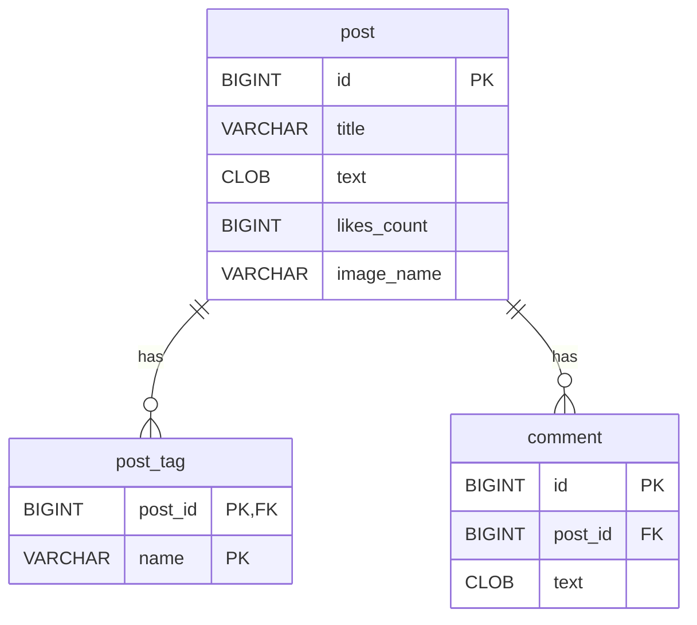

# blog-platform-api
RESTful backend service for a blog platform built with Java, Spring Framework (Web MVC, JDBC), H2, and Apache Tomcat

## Features

- Posts: create, read, update, delete, paged feed
- Search by title substring and tags
- Likes
- Post images
- Comments: create, read, update, delete

## API

Base URL: `http://localhost:8080`

### Posts — `PostController`

| Method | Path | Description |
|---|---|---|
| GET | `/api/posts?search=&pageNumber=&pageSize=` | Paged post feed with search |
| GET | `/api/posts/{id}` | Get a post |
| POST | `/api/posts` | Create a post |
| PUT | `/api/posts/{id}` | Update a post |
| DELETE | `/api/posts/{id}` | Delete a post with all its comments |
| POST | `/api/posts/{id}/likes` | Increment likes, returns the new count |

### Images — `PostImageController`

| Method | Path | Description |
|---|---|---|
| PUT | `/api/posts/{id}/image` | Upload a post image (`multipart/form-data`, field `image`) |
| GET | `/api/posts/{id}/image` | Get post image bytes |

### Comments — `CommentController`

| Method | Path | Description |
|---|---|---|
| GET | `/api/posts/{postId}/comments` | List post comments |
| GET | `/api/posts/{postId}/comments/{commentId}` | Get a comment |
| POST | `/api/posts/{postId}/comments` | Add a comment |
| PUT | `/api/posts/{postId}/comments/{commentId}` | Update a comment |
| DELETE | `/api/posts/{postId}/comments/{commentId}` | Delete a comment |

### Search rules

- The search string is split into words by whitespace; empty words are ignored
- Words starting with `#` are tags; a post must contain all of them
- Other words are joined with a space and matched as a substring of the title
- Title and tag conditions are combined with AND
- In the feed, post text longer than 128 characters is truncated and ends with `…`

## Architecture

Layered architecture: `Controller → Service → DAO → Database`

| Package     | Responsibility |
|-------------|---|
| `controller` | REST endpoints, HTTP mapping |
| `service`   | Business logic, transactions, entity ↔ DTO mapping |
| `dao`       | SQL access via `JdbcTemplate`, row mapping with `RowMapper` |
| `storage`   | Image file storage |
| `model`     | Domain entities |
| `dto`       | API request and response objects |
| `config`    | Spring and servlet container configuration |

## Database

H2 database. The schema is created on startup from
[`schema.sql`](src/main/resources/schema.sql)

- Tags are stored in a separate table, one row per tag (without `#`)
- Deleting a post deletes its tags and comments (`ON DELETE CASCADE`)
- Images are stored on disk; the table keeps only the file name
- `commentsCount` is not stored, it is calculated with `COUNT(*)`
