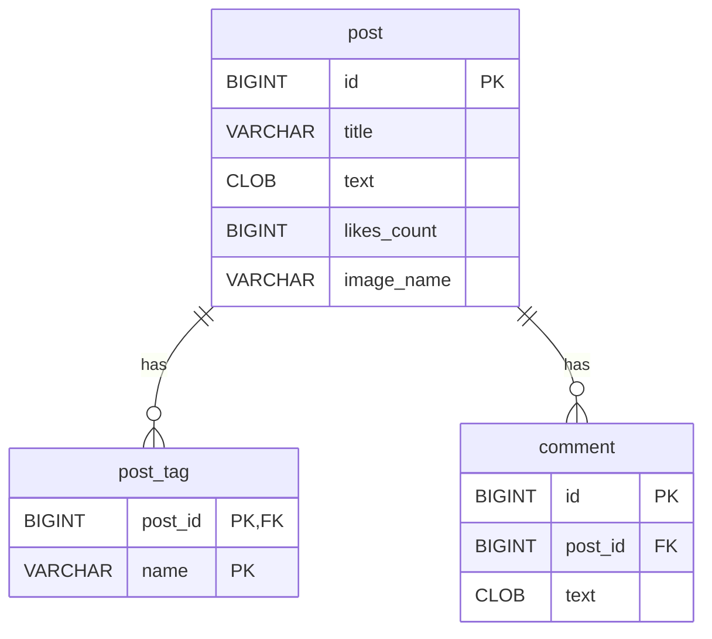

# blog-platform-api
RESTful backend service for a blog platform built with Java, Spring Framework (Web MVC, JDBC), H2, and Apache Tomcat.
Packaged as a WAR and used by a ready-made React frontend.

[Build and run instructions](#build-and-deployment)

## Features

- Posts: create, read, update, delete, paged feed
- Search by title substring and tags
- Likes
- Post images
- Comments: create, read, update, delete

## Tech stack

- Java 21
- Spring Framework 6.2: Web MVC, dependency injection and transaction management
- Spring JDBC: SQL access through `NamedParameterJdbcTemplate`
- H2: file-based database for the application, in-memory database for integration tests
- Jakarta Bean Validation with Hibernate Validator
- Maven, WAR packaging, external Apache Tomcat
- JUnit 5, Mockito, Spring Test and MockMvc

The application uses plain Spring Framework without Spring Boot.
The application context is configured with Java configuration classes and initialized through `web.xml`.

## API

Base URL: `http://localhost:8080`

### Posts — `PostController`

| Method | Path | Description |
|---|---|---|
| GET | `/api/posts?search=&pageNumber=&pageSize=` | Paged post feed with search |
| GET | `/api/posts/{id}` | Get a post |
| POST | `/api/posts` | Create a post |
| PUT | `/api/posts/{id}` | Update a post |
| DELETE | `/api/posts/{id}` | Delete a post with all its comments |
| POST | `/api/posts/{id}/likes` | Increment likes, returns the new count |

### Images — `PostImageController`

| Method | Path | Description |
|---|---|---|
| PUT | `/api/posts/{id}/image` | Upload a post image (`multipart/form-data`, field `image`) |
| GET | `/api/posts/{id}/image` | Get post image bytes |

- Max size: 5 MB per file, 10 MB per request (`<multipart-config>` in `web.xml`)
- Allowed extensions: `jpg`, `jpeg`, `png`, `gif`, `webp`
- Empty files and unsupported extensions are rejected with `400 Bad Request`- `GET` sets `Content-Type` from the file extension
- `404` if the post does not exist or has no image

### Comments — `CommentController`

| Method | Path | Description |
|---|---|---|
| GET | `/api/posts/{postId}/comments` | List post comments |
| GET | `/api/posts/{postId}/comments/{commentId}` | Get a comment |
| POST | `/api/posts/{postId}/comments` | Add a comment |
| PUT | `/api/posts/{postId}/comments/{commentId}` | Update a comment |
| DELETE | `/api/posts/{postId}/comments/{commentId}` | Delete a comment |

### Errors

Errors are returned as `application/problem+json` ([RFC 9457](https://www.rfc-editor.org/rfc/rfc9457)):

```json
{ "type": "about:blank", "title": "Not Found", "status": 404, "detail": "Post not found: 42", "instance": "/api/posts/42" }
```

Exception: path and query parameter type mismatch errors return `400 Bad Request`
with an empty body for compatibility with the bundled frontend.
See [Known important frontend issues](#known-important-frontend-issues)

### Feed and search rules

- The search string is split into words by whitespace; empty words are ignored
- Words starting with `#` are tags; a post must contain all of them
- Tags are case-insensitive: `#Java` and `#java` are the same tag
- Other words are joined with a space and matched as a case-insensitive substring of the title
- `%` and `_` in the search are matched literally, not as SQL wildcards
- Title and tag conditions are combined with AND; an empty search returns all posts
- Posts are ordered by id, newest first
- In the feed, post text longer than 128 characters is truncated and ends with `…`

| Search | Matches |
|---|---|
| `java` | titles containing "java" in any case |
| `#java #spring` | posts tagged with both `java` and `spring` |
| `boot #java` | posts tagged `java` with "boot" in the title |

## Architecture

Layered architecture: `Controller → Service → DAO → Database`

| Package     | Responsibility                                                             |
|-------------|----------------------------------------------------------------------------|
| `controller`| REST endpoints, HTTP mapping, error handling (ProblemDetail)               |
| `service`   | Business logic, transactions, entity ↔ DTO mapping                         |
| `dao`       | SQL access via `NamedParameterJdbcTemplate`, row mapping with `RowMapper`  |
| `storage`   | Image file storage                                                         |
| `model`     | Domain entities                                                            |
| `dto`       | API request and response objects                                           |
| `config`    | Spring and servlet container configuration                                 |
| `exception` | Domain exceptions (`NotFoundException` and subclasses)                     |


### Image storage

- Files are stored on disk outside the servlet container; the database keeps only the file name
- File names are generated by the server (UUID + extension) to prevent path traversal and collisions
- On replace: the new file is written, the database is updated, then the old file is removed
- On post deletion: the file is removed after the transaction commits (`@TransactionalEventListener`)

## Database

H2 database. The schema is created on startup from
[`schema.sql`](src/main/resources/schema.sql)



- Tags are stored in a separate table, one row per tag (without `#`)
- Deleting a post deletes its tags and comments (`ON DELETE CASCADE`)
- Images are stored on disk; the table keeps only the file name
- `commentsCount` is not stored, it is calculated with `COUNT(*)`

## Configuration

`src/main/resources/application.properties`:

| Property | Value | Description |
|---|---|---|
| `db.driver-class-name` | `org.h2.Driver` | JDBC driver |
| `db.url` | `jdbc:h2:file:~/blog-data/blog` | File-based H2 database, survives restarts |
| `db.username` | `blog_app_user` | Database user |
| `db.password` | `${BLOG_DB_PASSWORD}` | Taken from the environment variable, never committed |
| `images.dir` | `${user.home}/blog-data/images` | Directory for uploaded images, created on startup |

### Database password

The password is read from the `BLOG_DB_PASSWORD` environment variable,
which must be visible to the Tomcat process. Create `bin/setenv.sh`
in the Tomcat installation (Tomcat runs it on startup):

```bash
echo 'export BLOG_DB_PASSWORD=your_password' > "$(brew --prefix tomcat)/libexec/bin/setenv.sh"
chmod +x "$(brew --prefix tomcat)/libexec/bin/setenv.sh"
```

H2 sets the password when the database file is created on first startup.
To change it later, delete `~/blog-data/blog.mv.db` (all data is lost)
or run `ALTER USER blog_app_user SET PASSWORD '...'`.

## Requirements

- Java 21
- Maven 3.9+
- Apache Tomcat 10.1+ (Jakarta Servlet 6.0)
- Docker Desktop (to run the frontend); on macOS enable host networking, see [Frontend](#frontend)

## Build and deployment

The application is packaged as a WAR and runs on an external Apache Tomcat

### Build

Run from the project root:

```bash
mvn clean package
```

The resulting archive is `target/ROOT.war`.

### Deploy (macOS / Homebrew)

First deployment: set BLOG_DB_PASSWORD (see Database password)

Stop Tomcat:

```bash
brew services stop tomcat
```

Remove the previous WAR and its unpacked directory in Tomcat's webapps:

```bash
rm -f "$(brew --prefix tomcat)/libexec/webapps/ROOT.war"
rm -rf "$(brew --prefix tomcat)/libexec/webapps/ROOT"
```

Copy the new built archive:

```bash
cp target/ROOT.war "$(brew --prefix tomcat)/libexec/webapps/ROOT.war"
```

Start Tomcat:

```bash
brew services start tomcat
```

### Frontend

The React frontend is provided as a separate archive with the assignment
(`dist`, `nginx.conf`, `Dockerfile`, `docker-compose.yaml`). It is served by Nginx on port 80
and calls the backend at `http://localhost:8080` directly from the browser
(CORS is enabled for `http://localhost`).

1. Start Docker Desktop.
2. On macOS, enable host networking once: Docker Desktop → Settings → Resources → Network →
   **Enable host networking** → Apply & restart. The frontend's `docker-compose.yaml` uses
   `network_mode: host`, which is not available on macOS by default.
3. Unpack the archive and start the container:

```bash
cd front-app
docker compose up -d
docker ps
```

4. Open `http://localhost`.

Stop the frontend:

```bash
docker compose down
```

### Logs

```bash
tail -n 100 "$(brew --prefix tomcat)/libexec/logs/catalina.$(date +%F).log"
tail -n 100 "$(brew --prefix tomcat)/libexec/logs/localhost.$(date +%F).log"
```

## Usage

Use the frontend at `http://localhost`, or call the API directly:

```bash
# create a post
curl -X POST localhost:8080/api/posts -H 'Content-Type: application/json' \
  -d '{"title":"Hello","text":"First post","tags":["java","spring"]}'

# upload an image
curl -X PUT localhost:8080/api/posts/1/image -F 'image=@cat.png'

# feed: page 1, 5 posts per page, search by title and tag
# (# must be URL-encoded, so --data-urlencode is used)
curl --get localhost:8080/api/posts --data-urlencode 'search=hello #java' \
  -d pageNumber=1 -d pageSize=5

# like a post
curl -X POST localhost:8080/api/posts/1/likes

# add a comment
curl -X POST localhost:8080/api/posts/1/comments -H 'Content-Type: application/json' \
  -d '{"text":"Nice post","postId":1}'
```

## Tests

Run all tests from the project root:

```bash
mvn clean test
```

Run only integration tests:

```bash
mvn -Dtest=PostDaoIntegrationTest,PostMvcIntegrationTest test
```

### Unit tests

JUnit 5 and Mockito tests cover:

- Search query parsing
- Post creation, retrieval, update, deletion, likes and pagination
- Tag normalization and rejection of tags longer than 64 characters
- Comment creation, retrieval, update and deletion, including key error cases
- Empty image rejection and successful image replacement

Service unit tests use mocked DAOs and real DTO mappers without starting a Spring application context.

### Integration tests

Integration tests use Spring TestContext, real application components and an in-memory H2 database:

- DAO: combined title and tag filtering, LIMIT/OFFSET and cascade deletion
- MVC: post page JSON, missing post responses and path/body ID mismatch

DAO and MVC tests inherit the same context configuration from `AbstractIntegrationTest`, allowing Spring to reuse the cached application context.
Each test runs in a transaction that is rolled back afterward.

Test properties override the application database connection.
Integration tests do not use the file-based application database or require `BLOG_DB_PASSWORD`.

Maven Surefire loads Mockito as a Java agent.
When tests are run directly with the IDE's JUnit runner, additional agent configuration may be needed.

Test reports are generated in `target/surefire-reports`.

### Known important frontend issues

The bundled frontend is used as is. These issues are on the frontend side;
the backend either tolerates them or they need a workaround.

- **Comments requested with `postId=undefined`.** The post page requests
  `/api/posts/undefined/comments` before the post is loaded and crashes if the
  error body is valid JSON. The backend returns 400 with an empty body for
  type mismatch errors, so the page renders; an "Unexpected end of JSON input"
  alert may appear.
- **Comment update URL.** `PUT` is sent to
  `/api/posts/{commentId}/comments/{commentId}`; the correct `postId` is only
  in the request body.
- **Saving a post without a new image.** The browser console shows
  `Failed to execute 'append' on 'FormData'`. The post itself is saved;
  the image request is not sent.
- **Reloading a post page returns 404.** The bundled `nginx.conf` is shadowed
  by the default `default.conf` of the nginx image, so `/posts/{id}` is not
  routed to `index.html`. Open posts from the feed instead of reloading.
- **Validation errors are not displayed.** The frontend does not handle
    error responses, so a request rejected with 400 (for example, a post with
    a blank title) is not reported in the UI. The validation result can be seen
    in the browser network tab or by calling the API directly (see API usage).
